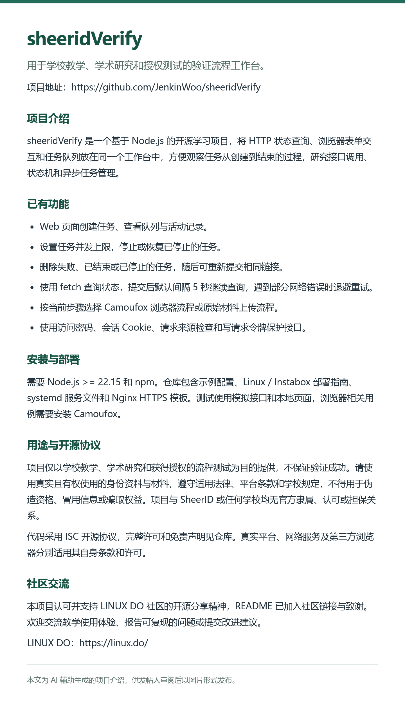

# LINUX DO 发帖草稿

建议标题：**[开源] sheeridVerify：用于教学与研究的 Node.js 验证流程工作台**

发布时请选择 [开源推广](https://linux.do/tag/2234-tag/2234) 标签，将下面的介绍图片实际上传至帖子，并确认 GitHub 仓库已公开且所需源码完整可获取。下列“是”为发帖人提供的承诺模板，需要发帖人核实并同意后使用；本文件不表示帖子已经发布、截图已经上传或社区已经审核通过。

README 已加入 [LINUX DO 社区认可与致谢](../README.md#社区认可与致谢)。以下为可复制的帖子正文。

---

#### 本帖使用社区开源推广，符合推广要求。我申明并遵循社区要求的以下内容：

- **我的帖子已经打上 [开源推广](https://linux.do/tag/2234-tag/2234) 标签：** 是
- **我的开源项目完整开源，无未开源部分：** 是
- **我的开源项目已链接认可 LINUX DO 社区：** 是
- **我帖子内的项目介绍，AI生成、润色内容部分已截图发出：** 是
- **以上选择我承诺是永久有效的，接受社区和佬友监督：** 是

*以下为项目介绍正文内容，AI生成、润色内容已使用截图方式发出*

项目仓库：https://github.com/JenkinWoo/sheeridVerify

社区链接：https://linux.do/
